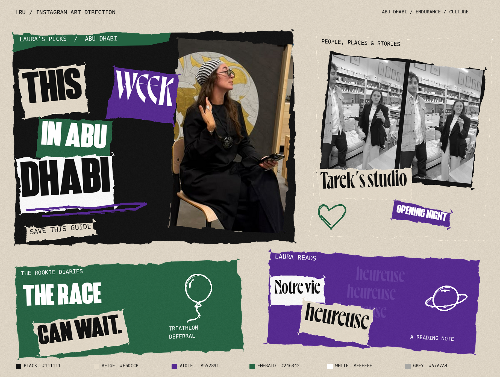
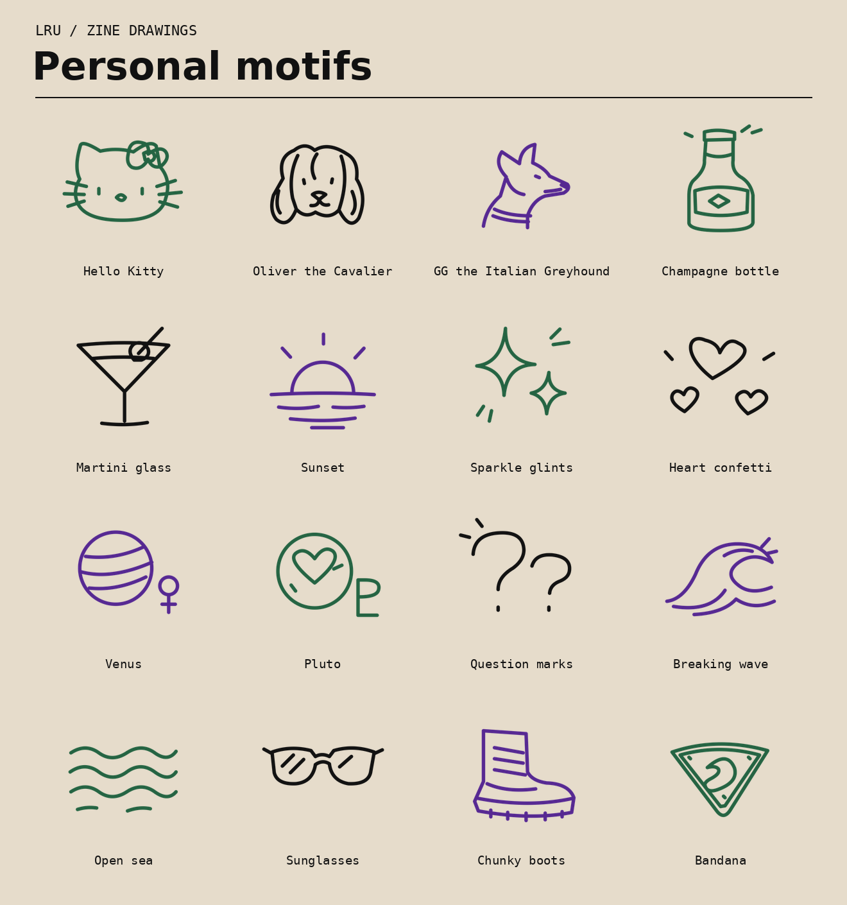

# LRU Visual Identity

The approved Instagram art direction and reusable zine drawings for Laura Rojas Uribe.

## Art direction

[Open the approved art direction board](art-direction/LRU_Instagram_Art_Direction.png)

Use real photography, uneven paper edges, oversized type, and rough pen marks. Preserve faces and glasses in original photographs.

| Type | Role |
| --- | --- |
| Eros Condensed | Editorial headlines and the LRU signature |
| Hennigar | Bold poster headlines |
| Inter | Dates, captions, and practical details |

| Color | Hex |
| --- | --- |
| Black | `#111111` |
| Beige | `#E6DCCB` |
| Emerald | `#246342` |
| Violet | `#552891` |
| White | `#FFFFFF` |
| Grey | `#A7A7A4` |

## Drawings

[Download the drawing pack](drawings/LRU_Zine_Drawing_Pack.zip). It contains 25 drawings in black, white, emerald, and violet, for 100 transparent PNGs.

[Original shapes preview](drawings/LRU_Zine_Drawing_Preview.png)

